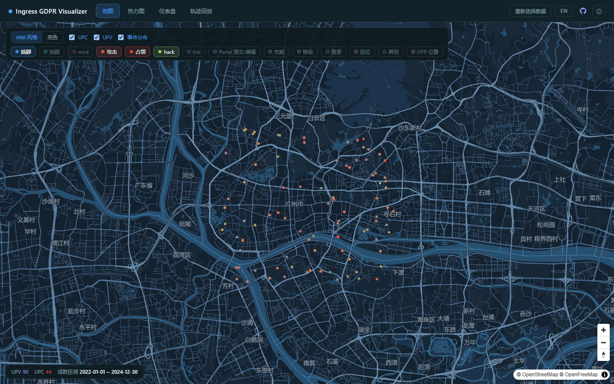
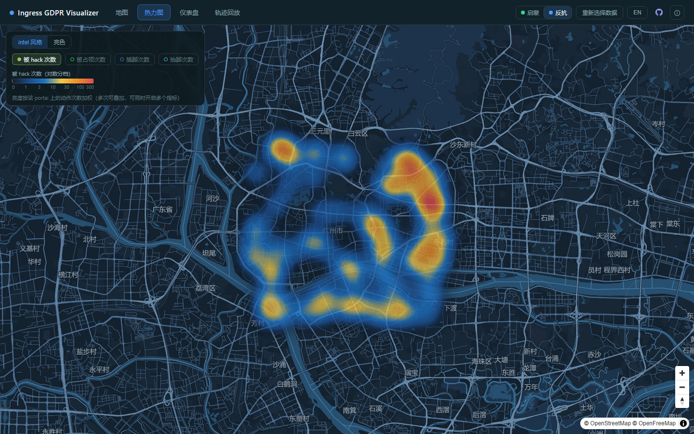
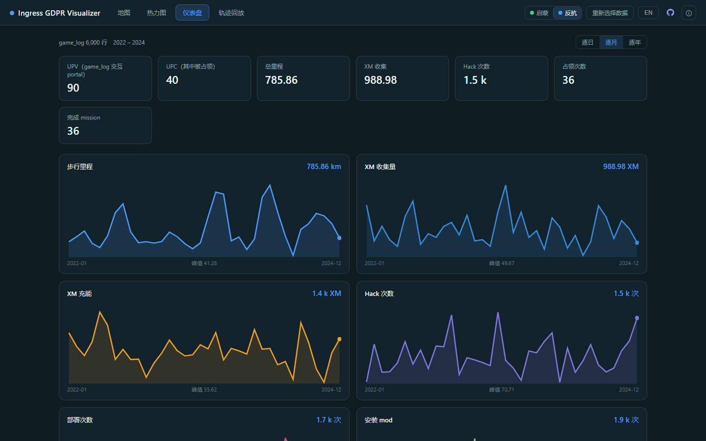
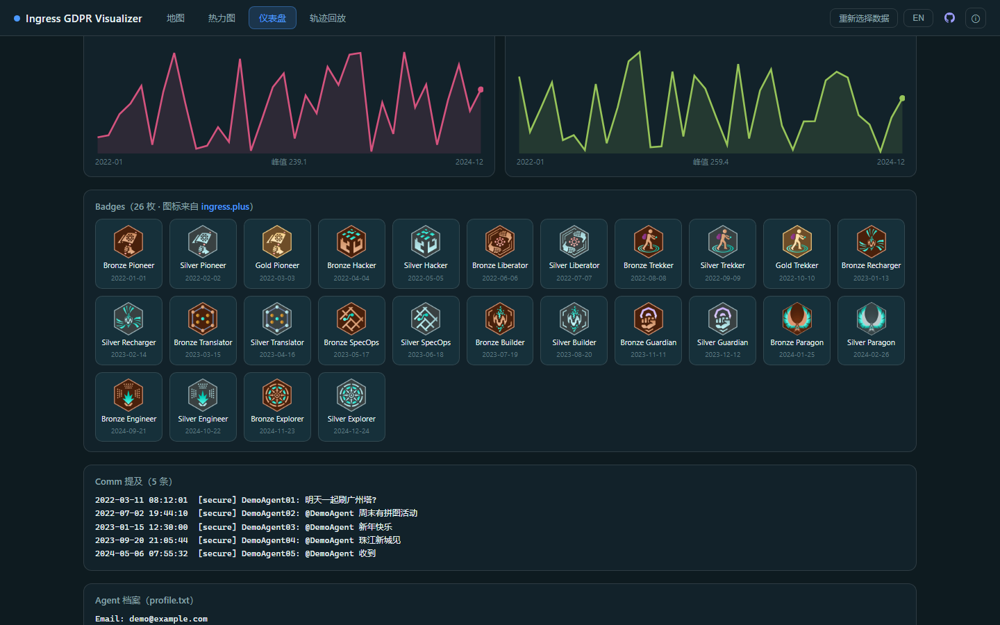
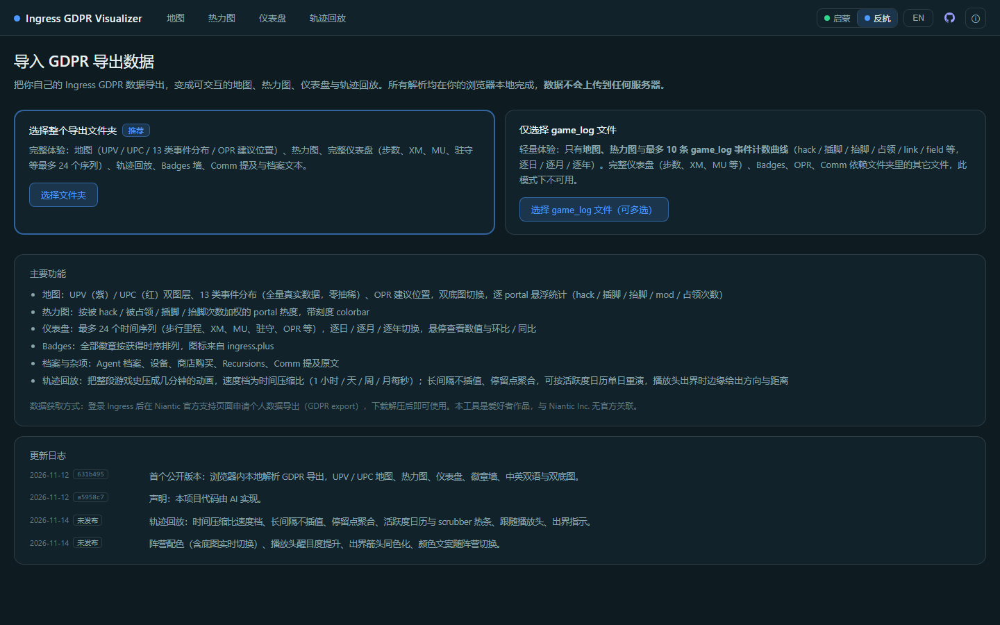
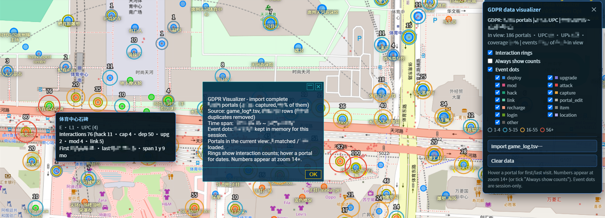

# Ingress GDPR Visualizer

> 把 Niantic Ingress 的个人数据导出（GDPR export）变成可交互的地图、热力图、仪表盘与轨迹回放。
> **所有解析都在本地完成，数据不会上传到任何服务器。**

[English](README_EN.md) · [中文](#快速开始)

本项目是爱好者作品，**仓库内不含任何原始个人数据文件**。你需要在浏览器里选择自己的 GDPR 导出文件夹（或仅 `game_log` 文件），或先用命令行脚本生成产物；`data/`、`raw/` 均已被 `.gitignore` 排除。

## 截图

以下 6 张网页版截图使用**合成的广州示例数据**（完全虚构，不含任何真实个人数据）。

| 地图 | 热力图 |
| --- | --- |
|  |  |

| 仪表盘 | Badges |
| --- | --- |
|  |  |

| 轨迹回放 | 开箱选数据 |
| --- | --- |
|  |  |

## 功能与更新记录

下表按时间排列，同时作为本项目的更新日志（日期为功能落地时间）。

| 日期 | 页面 | 内容 |
| --- | --- | --- |
| 2026-11-12 | **地图** | UPV / UPC 双图层；13 类事件分布（全量真实数据，**零抽稀**）；OPR 建议位置；intel 暗色 / 亮色双底图；逐 portal 悬浮统计（hack、插脚、抬脚、mod、占领次数） |
| 2026-11-12 | **热力图** | 按被 hack / 被占领 / 插脚 / 抬脚次数加权的 portal 热度，带刻度 colorbar，多指标可叠加 |
| 2026-11-12 | **仪表盘** | 最多 24 个时间序列（步数、XM、MU、驻守、OPR 等），逐日 / 逐月 / 逐年切换；悬停显示数值、环比、同比；统计卡、Badges 墙、Comm 提及与档案文本 |
| 2026-11-12 | **通用** | 中 / 英双语切换、GitHub 链接与爱好者声明弹层、随时「重新选择数据」、深色主题 |
| 2026-11-14 | **轨迹回放** | 时间压缩比速度档（1 小时 / 天 / 周 / 月每秒）；长间隔不插值、停留点聚合；活跃度日历与 scrubber 热条、单日重演、跟随播放头、出界方向与距离；事件点全量不抽稀 |
| 2026-11-14 | **通用** | 阵营配色（启蒙 / 反抗，UI 与底图实时切换） |
| 2026-11-15 | **IITC 插件** | intel 地图上的独立图层：交互次数环（分位数自适应分档、随缩放连续变化）、次数数字、悬浮显示首次 / 最近访问与分类明细、按类别勾选的原始事件点、视野内 UPC / UPV 覆盖率 |

### 两种数据装载方式

打开应用时若没有预生成数据，会自动显示**选数据屏**：

1. **选择整个导出文件夹（推荐）**：完整体验——地图、热力图、完整仪表盘、Badges、OPR、Comm。
2. **仅选择 `game_log` 文件**：轻量体验——地图、热力图，以及最多 10 条由事件时间戳统计出的曲线（hack / 插脚 / 抬脚 / 占领 / link / field 等）。步数、XM、MU、Badges、OPR 等依赖其它文件，此模式下不可用。

也可以先用 Node CLI 预生成：

```bash
npm run ingest -- --src /path/to/your/gdpr/export
```

产物写入 `data/`：`portals.geojson`、`events.json`（紧凑列式，全量事件）、`dashboard.json`、`opr.geojson`、`meta.json`。**源目录严格只读**，脚本不会修改它。

> 数据口径原则：**地图页只使用 `game_log` 单一来源**；仪表盘的专项时间序列仍需各 `.tsv` 文件（它们的覆盖起点通常早于 `game_log`，且 XM / MU / 驻守快照等维度在 game_log 中没有对应事件）。

---

## 快速开始

要求：Node.js ≥ 20，现代浏览器（Chrome / Edge 支持原生文件夹选择；其它浏览器自动降级为兼容模式）。

```bash
git clone https://github.com/cantonres/ingress-gdpr-personal-data-visualizer.git
cd ingress-gdpr-visualizer
npm install
npm run dev            # http://127.0.0.1:5173
```

首次打开会显示选数据屏；选择你的 GDPR 导出文件夹即可。若要预生成数据（例如部署静态站点），先跑 `npm run ingest`，再：

```bash
npm run build          # 产物在 dist/，会带上应用需要的 5 个数据文件
npm run preview        # 本地预览构建产物
```

构建产物是纯静态站点。**部署注意事项见下方「隐私与数据边界」——本工具面向本地部署，不建议线上部署。**

### 数据从哪里来

在 Niantic 官方支持页面申请**个人数据导出（GDPR / Data Export）**，下载并解压，得到 `game_log.tsv`、`portal_history.tsv`、`*.tsv` 时间序列、`profile.txt`、`OprSubmissionLog.csv` 等文件。把整个文件夹交给本工具即可。

### 常用脚本

| 命令 | 作用 |
| --- | --- |
| `npm run dev` | 启动 Vite 开发服务器 |
| `npm run build` | 构建静态站点（含 `data/`） |
| `npm run preview` | 预览构建产物 |
| `npm run ingest -- --src <dir> [--out <dir>]` | 预处理 GDPR 导出，生成 `data/` |
| `npm run catalog` | 刷新 `src/data/badgeCatalog.js`（ingress.plus 徽章图标 URL 表） |
| `npm run build:iitc` | 由模板 + 解析内核重新生成 IITC 插件产物 |
| `npm run check:iitc` | 校验 IITC 产物与源码一致（CI 门禁） |

---

## IITC 插件（可选）

`iitc/gdpr-visualizer.user.js` 是随仓库分发的单文件用户脚本，在 [IITC-CE](https://iitc.app/) 的 intel 地图上叠加一层你自己的 GDPR 历史。**不需要先跑本工具**：它直接解析原始 `game_log*.tsv`，与网页版共用同一份解析内核（`src/lib/ingestCore.js`），portal 集合与交互次数口径一致。

把鼠标悬停在 portal 上，会显示阵营 / 等级、UPC 状态、交互总次数与分类明细（hack、占领、部署、升级、mod、link等），以及首次访问、最近访问和两者间隔。面板底部给出当前视野内的 portal 数、UPC / UPV 与覆盖率，统计只算地图范围内的 portal。



> 该截图来自一次真实 GDPR 导出，已对统计数字做马赛克处理，仅用于展示界面形态；图中不包含可读的个人数据。

**安装**：用 Tampermonkey / Violentmonkey 安装 `iitc/gdpr-visualizer.user.js`（文件头已声明 `@match https://intel.ingress.com/*`），或在 IITC-CE 的插件管理里从仓库 raw 地址添加。插件头部带 `@updateURL` / `@downloadURL`，后续更新由用户脚本管理器处理。

**使用**：打开 intel 地图 → 工具箱出现唯一入口 **GDPR data visualizer** → 点开菜单：

| 菜单项 | 作用 |
| --- | --- |
| **Import game_log.tsv…** | 选择 `game_log.tsv`（可多选，副本会自动去重）。只接受 `game_log*.tsv`；不支持文件夹或预生成的 geojson |
| **Interaction rings / Always show counts** | 按每个 portal 的交互总次数分档画环，断点由本次导入数据的 p50 / p80 / p95 自适应，图例显示实际区间；环随地图缩放连续变化，放大到 14 级以上自动标出次数 |
| **Event dots + 类别勾选** | 按类别叠加原始事件点，例如炸、登录、拾取/丢掉item等 |
| **Clear data** | 清除本机保存的索引与内存中的事件数据 |

插件是独立的 canvas 图层，**不修改 portal 的 `fillColor`**，因此可与 IITC 内核自带的 portal history 高亮器同时开启。

> 隐私：插件不发起任何网络请求，全部在页面内解析。但导入后的 portal 索引（约 1 米精度坐标、交互次数、首次 / 最近访问时间）保存在 `intel.ingress.com` 的 localStorage，**同源脚本理论上可读**；全量事件点只存在于内存、刷新页面即失效，需要时重新导入。共用电脑使用后请点 **Clear data**。

---

## 目录结构

```
├── index.html               # 入口（含 favicon）
├── public/favicon.svg       # 站点图标
├── docs/screenshots/        # README 截图（网页版为合成示例数据，IITC 截图已脱敏）
├── iitc/
│   ├── src/template.js      # 插件模板（由构建脚本填入解析内核）
│   └── gdpr-visualizer.user.js  # 生成产物，可直接安装
├── scripts/
│   ├── ingest.mjs           # CLI：读原始导出 → data/
│   ├── build-iitc.mjs       # 由模板 + 解析内核生成 IITC 插件产物
│   └── fetch-badge-catalog.mjs
├── src/
│   ├── lib/ingestCore.js    # 解析内核（Node CLI / 浏览器共用）
│   ├── dataContext.js       # 预生成 / 浏览器本地解析两条数据路径
│   ├── faction.js           # 阵营配色（UI 强调色 + 底图调色）
│   ├── changelog.js         # 录入页「更新日志」
│   ├── i18n.jsx             # 中英双语字典
│   ├── data/                # intel / 亮色底图样式、徽章图标 URL 表
│   └── components/          # 地图、热力图、仪表盘、轨迹回放、Onboarding 等
└── .github/workflows/       # CI：IITC 产物一致性 + 构建 + 依赖审计
├── data/                    # ⛔ 本地生成、已 gitignore（含个人数据）
└── dist/                    # ⛔ 构建产物、已 gitignore
```

---

## 隐私与数据边界

- 浏览器模式：**不上传任何文件**，全部在页面内用 `src/lib/ingestCore.js` 解析；
- CLI 模式：只读取 `--src` 指定目录，输出写到 `--out`，**不写回源目录**；
- `data/`、`raw/`、`node_modules/`、`dist/` 全部被 `.gitignore` 排除；
- 徽章图标热链自 [ingress.plus](https://ingress.plus/badges)，不下载到本仓库；地图瓦片来自 [OpenFreeMap](https://openfreemap.org/) / OpenStreetMap；
- `npm run build` 只把 `meta.json`、`dashboard.json`、`portals.geojson`、`events.json`、`opr.geojson` 五个文件拷进 `dist/data`。其中 `meta.json` 含档案 / Comm 原文、`events.json` 与 `portals.geojson` 含精确位置——**它们仍是真实个人数据**；
- IITC 插件不发起网络请求，但会把约 1 米精度坐标、交互次数与首次 / 最近访问时间写入 `intel.ingress.com` 的 localStorage，同源脚本可读；详见上方「IITC 插件」章节。

> **关于部署**：本工具面向**本地部署**。虽然构建产物技术上可以放到线上静态服务器，但 GDPR 导出包含精确位置、时间、邮箱、设备等敏感个人信息，**不建议线上部署**；`dist/data` 里的文件就是你的真实数据，**不要公开托管 `dist/`**。

---

## 声明 / Disclaimer

- 本站 / 本工具为**爱好者作品，与 Niantic Inc. 无官方关联**；**Ingress 是 Niantic Inc. 的注册商标**。
- 本项目代码由 AI 实现。
- 本项目**不分发、不包含任何原始个人数据文件**；README 截图为合成数据或已脱敏。任何由用户导出的 GDPR 数据由用户自行负责保管、使用与合规。
- 徽章图标版权归其各自权利人所有，图片热链自 ingress.plus；地图数据 © OpenStreetMap contributors、© OpenFreeMap。
- 参考与致谢：[UPC-UPV-for-IITC](https://github.com/Choujingress/UPC-UPV-for-IITC)（思路参考）、[cantonres/.github](https://github.com/cantonres/.github)（社区新人教程中的游戏术语/专用词汇）、[md-atlas](https://github.com/ReiiNoki/md-atlas)（intel 风格底图参考）、[ingress.plus](https://ingress.plus/badges)（徽章图标）。

## License

[MIT](LICENSE) — 详见 [LICENSE](LICENSE) 文件。
