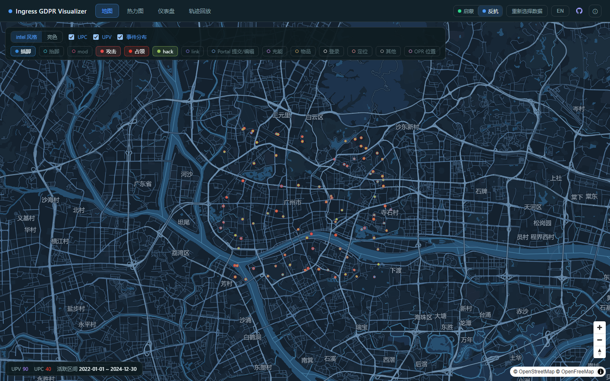
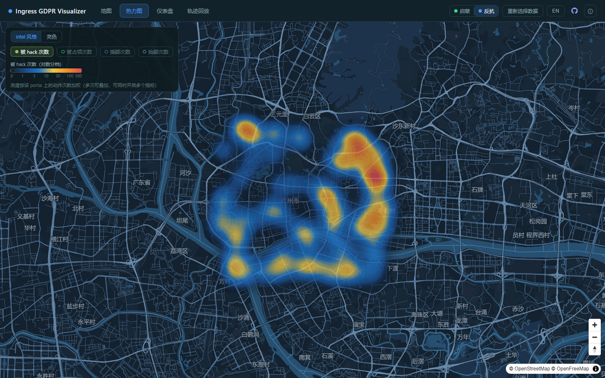
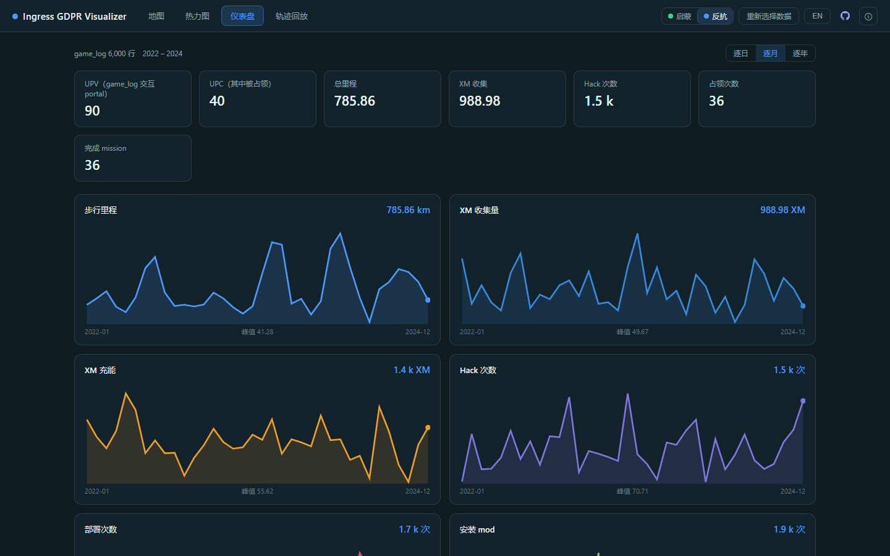
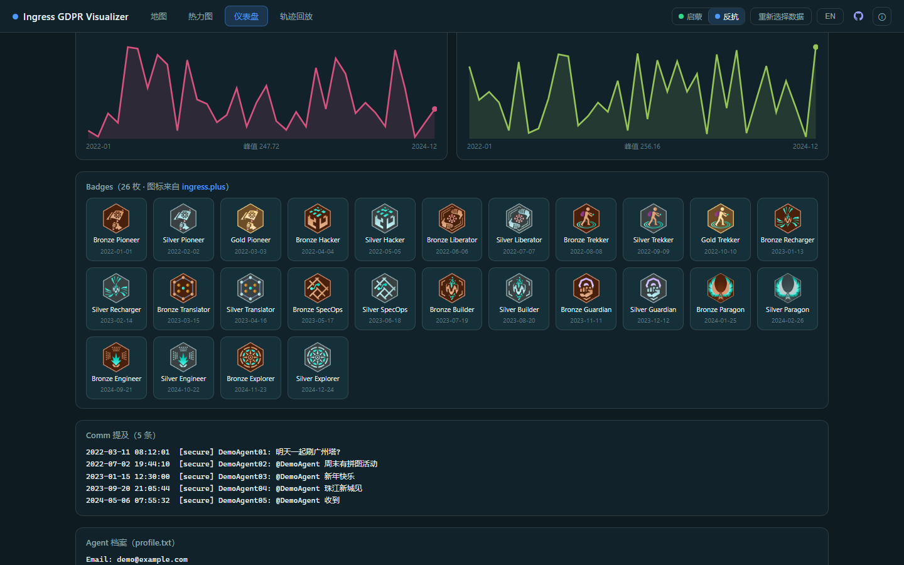
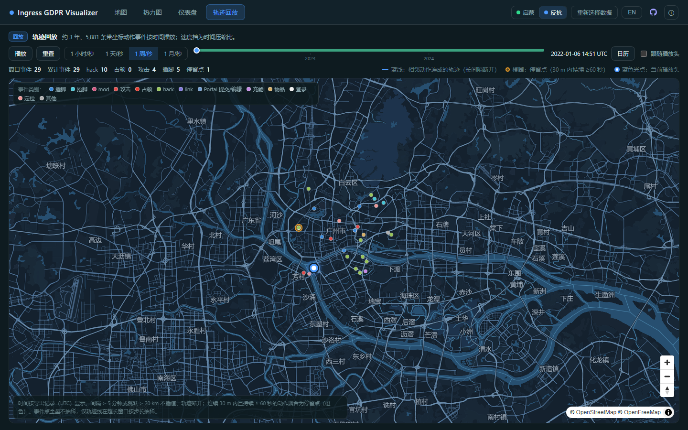
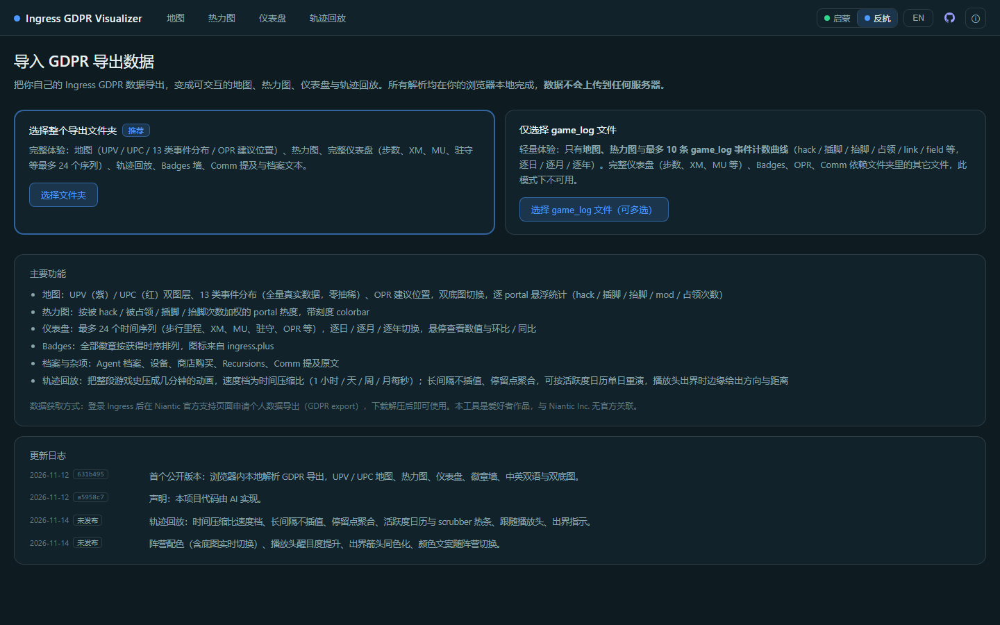

# Ingress GDPR Visualizer

> Turn your Niantic Ingress personal data export (GDPR export) into an interactive map, heatmap, dashboard and trajectory playback.
> **All parsing happens locally — your data is never uploaded to any server.**

[中文文档](README.md) · [English](#screenshots)

This is a fan-made project and **contains no personal data**. You pick your own GDPR export folder (or just the `game_log` file(s)) in the browser, or pre-generate the artifacts with a CLI script; `data/` and `raw/` are excluded by `.gitignore`.

## Screenshots

The screenshots below use **synthetic Guangzhou demo data** (entirely fictional, contains no real personal data).

| Map | Heatmap |
| --- | --- |
|  |  |

| Dashboard | Badges |
| --- | --- |
|  |  |

| Playback | Onboarding |
| --- | --- |
|  |  |

## Features & changelog

Rows are ordered by date; this table doubles as the project's changelog (dates are when each feature landed).

| Date | Page | Content |
| --- | --- | --- |
| 2026-11-12 | **Map** | UPV / UPC layers; 13 event categories (full real data, **zero sampling**); OPR suggested locations; Intel dark / light basemaps; per-portal hover stats (hacks, deploys, upgrades, mods, captures) |
| 2026-11-12 | **Heatmap** | Portal activity weighted by hacks / captures / deploys / upgrades, with a ticked colorbar; metrics can stack |
| 2026-11-12 | **Dashboard** | Up to 24 time series (distance, XM, MU, holding days, OPR...), daily / monthly / yearly views; hover for value, MoM and YoY; stat cards, Badges wall, Comm mentions and profile text |
| 2026-11-12 | **General** | 中文 / English toggle, GitHub link and fan-site disclaimer popover, "change data" anytime, dark theme |
| 2026-11-14 | **Playback** | Time-compression rates (1 hour / day / week / month per second); no interpolation across long gaps, dwell-stop aggregation; activity calendar and scrubber heat strip, single-day replay, follow-playhead, edge direction + distance; event points are never sampled |
| 2026-11-14 | **General** | Faction theme (Enlightened / Resistance — UI accent and basemap switch live) |

### Two ways to load data

If no pre-generated data exists, the app opens with a **data picker**:

1. **Choose the whole export folder (recommended)**: the full experience — map, heatmap, complete dashboard, Badges, OPR, Comm.
2. **Only the `game_log` file(s)**: lightweight — map, heatmap, and up to 10 event-count curves (hacks / deploys / upgrades / captures / links / fields...). Distance, XM, MU, Badges, OPR and Comm need the other files and are unavailable in this mode.

You can also pre-generate with the Node CLI:

```bash
npm run ingest -- --src /path/to/your/gdpr/export
```

Artifacts are written to `data/`: `portals.geojson`, `events.json` (compact columnar, full events), `dashboard.json`, `opr.geojson`, `meta.json`. The **source directory is strictly read-only** — the script never modifies it.

> Data scope principle: **the map only uses `game_log` as its single source**; the dashboard's dedicated time series still need the individual `.tsv` files (they usually cover a longer period than `game_log`, and dimensions like XM / MU / holding snapshots have no game_log events at all).

---

## Getting started

Requires Node.js ≥ 20 and a modern browser (Chrome / Edge support the native folder picker; other browsers fall back to a compat mode).

```bash
git clone https://github.com/cantonres/ingress-gdpr-personal-data-visualizer.git
cd ingress-gdpr-visualizer
npm install
npm run dev            # http://127.0.0.1:5173
```

The first launch shows the data picker; choose your GDPR export folder. To pre-generate data (e.g. for a static deployment), run `npm run ingest` first, then:

```bash
npm run build          # output in dist/; only the five data files the app fetches are copied
npm run preview        # preview the production build
```

The build output is a plain static site. **See "Privacy & data boundaries" below — this tool is designed for local deployment; hosting it online is not recommended.**

### Where the data comes from

Request a **personal data export (GDPR / Data Export)** from Niantic's official support page, download and unzip it — you get `game_log.tsv`, `portal_history.tsv`, the `*.tsv` time series, `profile.txt`, `OprSubmissionLog.csv` and more. Hand the whole folder to this tool.

### Scripts

| Command | Purpose |
| --- | --- |
| `npm run dev` | Start the Vite dev server |
| `npm run build` | Build the static site (includes `data/`) |
| `npm run preview` | Preview the production build |
| `npm run ingest -- --src <dir> [--out <dir>]` | Preprocess a GDPR export into `data/` |
| `npm run catalog` | Refresh `src/data/badgeCatalog.js` (badge icon URL table from ingress.plus) |

---

## Project layout

```
├── index.html               # entry point (includes favicon)
├── public/favicon.svg       # site icon
├── docs/screenshots/        # README screenshots (synthetic demo data)
├── scripts/
│   ├── ingest.mjs           # CLI: raw export → data/
│   └── fetch-badge-catalog.mjs
├── src/
│   ├── lib/ingestCore.js    # parsing core (Node CLI / browser)
│   ├── dataContext.js       # pre-generated / in-browser data paths
│   ├── faction.js           # faction theme (UI accent + basemap palette)
│   ├── changelog.js         # onboarding changelog
│   ├── i18n.jsx             # Chinese / English dictionary
│   ├── data/                # Intel / light basemap styles, badge icon URL table
│   └── components/          # map, heatmap, dashboard, playback, onboarding...
├── .github/workflows/       # CI: build + dependency audit
├── data/                    # ⛔ generated locally, gitignored (personal data)
└── dist/                    # ⛔ build output, gitignored
```

---

## Privacy & data boundaries

- Browser mode: **no files are uploaded** — everything is parsed in the page by `src/lib/ingestCore.js`;
- CLI mode: only reads the `--src` directory and writes to `--out`; the **source directory is never modified**;
- `data/`, `raw/`, `node_modules/` and `dist/` are all excluded by `.gitignore`;
- Badge icons are hotlinked from [ingress.plus](https://ingress.plus/badges) and are not stored in this repository; map tiles come from [OpenFreeMap](https://openfreemap.org/) / OpenStreetMap;
- `npm run build` copies only `meta.json`, `dashboard.json`, `portals.geojson`, `events.json` and `opr.geojson` into `dist/data` (`DATA-NOTES.md` and the raw export are never copied). `meta.json` still contains the profile / Comm text, and `events.json` / `portals.geojson` contain precise locations — **these are still real personal data**.

> **About deployment**: this tool is designed for **local deployment**. The build output can technically be hosted on a static server, but a GDPR export contains sensitive personal information (precise locations, timestamps, e-mail, devices), so **online deployment is not recommended** — the files in `dist/data` are your real data, so **never host `dist/` publicly**.

---

## ROADMAP

- [x] Trajectory playback (time-compression rates, no interpolation across long gaps, dwell aggregation, activity calendar)
- [ ] IITC plugin

---

## Disclaimer

- This site / tool is a **fan-made project, not affiliated with Niantic Inc.**; **Ingress is a registered trademark of Niantic Inc.**
- The code of this project was implemented by AI.
- This project **distributes and contains no personal data**; users are responsible for storing and handling their own GDPR exports.
- Badge icons are copyrighted by their respective owners and hotlinked from ingress.plus; map data © OpenStreetMap contributors, © OpenFreeMap.
- Credits: [UPC-UPV-for-IITC](https://github.com/Choujingress/UPC-UPV-for-IITC) (concept reference), [cantonres/.github](https://github.com/cantonres/.github) (in-game terminology from the community onboarding tutorials), [md-atlas](https://github.com/ReiiNoki/md-atlas) (Intel-style basemap reference), [ingress.plus](https://ingress.plus/badges) (badge icons).

## License

[MIT](LICENSE) — see the [LICENSE](LICENSE) file.
